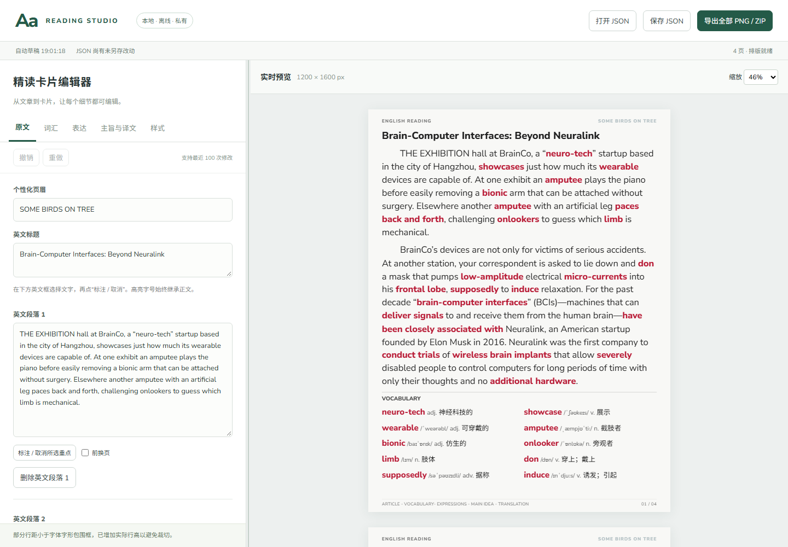

# 实施与验收报告

> 本报告记录初次实现的历史验收；后续代码整理及最新验证结果见 [CODE_REVIEW_REPORT.md](CODE_REVIEW_REPORT.md)。原始交接 ZIP 对照结论仅适用于当时环境，不代表后续复验重新检查过该 ZIP。

验收日期：2026-10-19（Asia/Shanghai）。实现位置：当前 handoff 目录。没有修改原始 `assets/projects/brainco/` 与 `assets/reference/v17/`；15 个文件已逐字节对照上级原始交接 ZIP。

## 结果

**Problem：** 原交接包只有需求、数据与手工分页的静态参考，不能持续编辑并可靠重开。

**Cause：** 历史 HTML 的视觉页片段混合了内容与版式，无法承担完整自然段、高亮引用和自动分页的权威数据模型。

**Changed：** 实现了 Windows 本地 React/TypeScript 编辑器、版本化 JSON、受控内容表单、精确高亮、撤销/重做、自动草稿、DOM 实测行级分页及共享渲染器的 Chromium PNG/ZIP 导出。

**Why：** 逻辑内容保持完整；行片段记录来源、起止位置、缩进和实际高度。分页器逐块断言区间从 0 连续覆盖到全文末尾，导出再核对完整项目与所有行位置的 SHA-256 指纹。文字合成层使用恒等 `filter: opacity(1)`，使滚动预览和截图采用一致抗锯齿，不改变色值或排版。

**Verified：** 数据测试 4/4，真实 Chromium E2E 12/12，TypeScript + Vite 构建成功；生产模式生成 4 页 1200×1600 PNG。所有 4 页的原尺寸预览截图与导出 PNG **逐字节相同**，重复导出各 PNG 亦逐字节相同，ZIP 可解压。

**Remaining risk：** 这些结论限于本次 Windows/Chromium 环境与所列用例；不证明所有输入、所有浏览器或操作系统的像素表现。超大项目主线程测量性能、孤行控制及下述可选功能仍需改进。

## 四阶段完成情况

| 阶段 | 完成项与证据 |
|---|---|
| Phase 1 骨架与数据 | React/TypeScript/Vite；Zod 校验与 v1→v2 迁移；BrainCo 两个完整英文自然段及两个完整译文段落；全部内容受控编辑；JSON 下载和重新导入；稳定 ID。`tests/model.test.ts` 对照独立 Markdown 快照。 |
| Phase 2 分页 | 独立 `src/services/pagination.ts`；Range 在浏览器实际字体下逐 grapheme 测行，非按字数估高；逐行跨页；表达的四子节点独立流动；续段不缩进；区间连续性断言；两栏词汇；无 10 页截断。 |
| Phase 3 编辑与导出 | 单处重点增删/局部取消；文字编辑后迁移高亮，受损引用取消并提示；会话历史 100 步；词汇/表达增删和上下排序；段落增删；预览点击定位；样式及恢复默认；手动前换页；本地字体；草稿隔离备份；单页 PNG 和整套 ZIP（含项目 JSON）。 |
| Phase 4 验收 | 单元、浏览器、全新安装、构建、生产演示及全部页面图像比对；独立只读代码审查后补充回归；Windows 操作说明与本报告。 |

## 实际运行环境与命令结果

- Windows，系统内核版本 `10.0.26300`；Node `24.19.0`、npm `11.17.0`。
- Playwright 锁定安装，实际 Chromium `156.0.8078.4`（build 1248）。无大模型 API 或付费截图服务。
- 在独立空目录用同一 `package.json` 生成完整锁文件，再执行 `npm ci`：成功安装 185 包；独立目录构建成功、4 个数据测试通过。根目录亦用最终锁文件重新执行 `npm ci --offline --cache .npm-cache`，退出码 0。
- 最初网络代理导致下载失败，早期中断安装还留下不完整锁文件；已从独立空目录重新生成锁文件并验证所有 236 个 package 元数据节点均有版本，最终安装可复现。最终锁文件不依赖早期残留。

```text
npm test
  Test Files 1 passed (1)
  Tests      4 passed (4)

npm run test:e2e
  12 passed

npm run build -- --logLevel error
  tsc --noEmit && vite build --logLevel error
  exit 0

npm run demo
  productionMode: true
  pageCount: 4
  dimensions: [1200, 1600]
  repeatIdentical: true
  previewIdentical: true
  externalRequests: []
  protectedFilesVerifiedAgainstOriginalZip: 15
```

机器可读结果：`artifacts/verification/unit.json`、`artifacts/verification/e2e.json`、`artifacts/demo/validation.json`。PNG 和项目文件的 SHA-256 在 `artifacts/demo/validation.json`。演示由生产构建运行生成，非引用旧 HTML 或旧 PNG。

安装过程中出现 npm 的 esbuild 安装脚本策略提示；平台二进制已安装，构建实际通过。普通构建曾出现上游 Zod 注释标记警告，浏览器测试有环境 `NO_COLOR` 提示；均非本项目测试失败。最终没有跳过或仍然失败的测试。

## 20 项验收逐条记录

测试位置：`tests/model.test.ts`、`tests/e2e/editor.spec.ts`、`tests/e2e/pagination.spec.ts`；生产图像核对：`tools/demo.ts`。

| # | 优先级 | 结果 | 实际证据及边界 |
|---|---|---|---|
| 1 | P0 | 通过 | 迁移后英文和译文均恰有 2 段；拼接内容与独立 article.md/translation.md 相同。原始内容附件另与 ZIP 字节对照，未重写或摘要化。 |
| 2 | P0 | 通过 | UI 修改第二段 supposedly 前后文本，撤销/重做，下载 JSON、解析下载内容、重新导入；刷新及独立 Chromium 进程关闭再启动均恢复修改。 |
| 3 | P1 | 通过 | 单元测试建立两处相同 word 的独立范围，只取消第一处，第二处保留；浏览器真实文本框选择、标注、取消同步到预览。 |
| 4 | P0 | 通过 | UI 词汇改词头、下移、添加和删除；表达改例句/译文、上下排序、添加删除；Main Idea 改写；下载 JSON 检查保存值并重开。排序通过按钮，未实现鼠标拖拽。 |
| 5 | P1 | 通过 | 清空译文第一段后保留空段占位并提示，其他段落不被删除。 |
| 6 | P0 | 通过 | 每页 PNG 文件头断言 1200×1600；卡片计算背景 RGB(248,248,246)；每页页脚页码与预览总数匹配，极端边距下页脚文字不碰撞。 |
| 7 | P0 | 通过 | 英文正文改为 34px 后重点实际计算字号为 34px；另测正文 60px、左右边距 200px、行距 1.2、中文 54px。检查固定容器及实际字形 Range 的右/下边界。 |
| 8 | P0 | 通过 | 单个例句写入 230 个带序号英文单词，该同一个例句跨越多页；所有行片段文本拼接与原文完全相同。 |
| 9 | P0 | 通过 | 按实际测量调整底部可用空间，短语下方仅留 10px，确认 phrase 在 N 页、meaning 在 N+1 页，例句仍保留。生产演示第 2→3 页也真实出现短语与释义拆分。 |
| 10 | P0 | 通过 | 长英文段与超长混合中文自然段均跨页；中文首行 64px 缩进，其后所有片段缩进为 0；英文同一机制。grapheme 边界断言覆盖 emoji、组合音标。 |
| 11 | P0 | 通过 | 极短项目 1 页包含 Main Idea 和 Translation 等三个模块标题；生产第 3 页主旨与译文相接。表达标题仅一个，续页不复制模块头。 |
| 12 | P1 | 通过 | 每行容器在内容区域内；极端样式还逐 grapheme 测实际字形右/下边界；所有业务字段文本逐字比较，起止区间连续；双栏等宽，词汇按原数组每行左→右排序。 |
| 13 | P1 | 通过 | 极短项目仅 1 页；长译文加倍夹具产生超过 10 页，未删内容。默认样例恰有 4 页是排版结果。 |
| 14 | P1 | 通过 | 500/800 字符无空格 token、混合中英数、连续中文标点、组合字符与 emoji、显式换行及 400 连续空格，拼接无字损且可见字形不越界。 |
| 15 | P0 | 通过 | ZIP 解压后 PNG 数量=预览页数；单 PNG 等于 ZIP 对应 PNG。生产演示全部 4 页原尺寸预览截图与各 PNG 逐字节相同。 |
| 16 | P1 | 通过 | 两次导出全部 PNG 逐字节相同；导出等待字体；旧/错误指纹及只改一个等长标题字符的项目均拒绝导出。字体请求失败时明确报错且禁止截图。 |
| 17 | P0 | 本机通过 | PowerShell 下全新独立目录 npm ci、构建、测试成功；生产服务真实运行。浏览器外部请求被阻断仍可编辑/导出，演示无应用外部请求。未另开全新 Windows 10 虚拟机验收。 |
| 18 | P0 | 通过 | UI 导入坏版本、坏 JSON、null 标题、乱码替代符报告“无法打开项目”，旧内容保留；单元另拒绝重复 ID、不匹配高亮、危险尺寸。 |
| 19 | P1 | 通过 | 草稿/JSON 下载状态清楚；刷新、真实浏览器进程重启可恢复；模拟配额失败可见提示；损坏草稿隔离保存；重渲染不清空内容。浏览器最终下载落盘仍需用户在下载列表确认。 |
| 20 | P1 | 通过 | 上述命令均实际执行；最终 4 个单元与 12 个 E2E 全部通过，附机器报告。 |

## 审查发现与已修复问题

| 原问题 | 原因与修复 | 回归证据 |
|---|---|---|
| 打开文件后短暂显示旧预览已就绪 | 读文件为异步，立即先清除 ready；失败时保留旧项目。 | 导入长项目后读取新内容与覆盖检查。 |
| 损坏草稿被默认样例覆盖 | 载入失败后自动缓存仍写原键。现在先隔离原始字符串，失败则停缓存；提供原始草稿下载。 | corrupt drafts / quota 用例。 |
| 合法业务 ID 与内部标题/表达冲突 | 覆盖表、编辑定位、手动分页各自使用逻辑类型命名空间；高亮仅应用于 article。 | title、x-1:example、mainIdea 业务 ID 回归。 |
| 多页词汇按全局两半分栏导致页间读序交错 | 改为按数组每行左→右配对，始终两等宽栏。 | 首次出现顺序与原 vocabulary 数组一致。 |
| 窄窗口页脚与导出字号不同 | 去除对视口尺寸的实际依赖，按画布内容宽度测量并设置固定字号。 | 1000→1800 窗口页脚字号不变及极端边距几何断言。 |
| 极小行距时字体 Range 越过页底 | 一行高度取请求行高和实际字体包围框的较大值，必要时提示。 | 60px/1.2 行距下全部可见字形保持在区域内。 |
| 连续中文标点输出后超出栏宽 | 浏览器 pre-wrap 测量的行末标点压缩与独立 pre 行输出宽度不同；增加实际输出行的 Range 复测，必要时减小测量宽度重排，保留原文和英文自然断词规则并提示。 | 连续 200 组中文标点、实际可见字形右边界及逐字保真检查。 |
| 后续滚动预览与导出抗锯齿不同 | 诊断确认预览切换到灰度 AA，导出仍 LCD AA；恒等滤镜统一文字合成，不修改文字或配色。 | 生产全部 4 页逐字节比较，不仅首张。 |
| 导出刚返回后再次请求偶发 busy | 返回响应前关闭 Chromium 并释放占用，成功和失败路径均处理。 | 连续成功导出、连续失败请求、等长内容变更拒绝。 |
| 仅用分页区间作指纹无法绑定内容 | 指纹加入完整项目及全部行记录，并 SHA-256；内容、标注或样式变化均绑定到当前快照。 | 只改等长标题仍拒绝旧指纹。 |

## 与 V17 的视觉差异

- 保留 1200×1600、米白背景、深灰文字、红色强调、绿色三处模块分割线、固定页眉和原样页脚。标题 40、正文/重点 36、短语 36、实际中文译文 32px。
- 使用打包 Nunito Sans 与 Noto Sans SC；旧参考所用字体环境未随交接打包，因此字形、字宽和换行不作旧 PNG 的像素复刻。目标是**新编辑器自身预览与导出一致**。
- 两个完整英文自然段先连续排完，再呈现词汇；不复刻旧参考的文章/对应词汇页内配对。词汇按行配对，阅读顺序与编辑列表一致。
- 中文是两个完整自然段连续排版，采用 32px；不照搬旧 `.zhline` 的 36px 或手工断句。
- Main Idea 与 Translation 可同页；表达可在字段或文字行之间跨页。页脚有明确预留区，旧参考的覆盖风险不保留。
- 默认样例最后一页仍有自然留白，因为末段较短；没有固定凑页、删减或为填满页面压缩译文。

## 未完成与改进项

以下不是已实现功能，不能由当前测试推导为已支持：

1. 单元素 `elementStyles` 仅兼容保存，未应用；只有全局样式控件。
2. 预览点击可定位编辑框，未实现直接在预览文字内输入或 Canvas 拖拽；排序为上下按钮，无鼠标拖动。
3. 手动分页 UI 位于逻辑块之前；不支持任意字符位置的分页标记。词汇按行成对，前换页作用于该行。
4. 未实现文章页与词汇的语义自动配对、孤行/寡行美化、表达间旧版细灰线等全部视觉细节；完整性优先。
5. 未实现 Markdown 导入/导出、standalone HTML、AI 初稿生成、云同步或桌面安装包。这些可作为后续扩展，不依赖外部账号才能用当前编辑器。
6. 撤销历史限当前会话 100 次，不持久化历史树；项目内容及样式可以持久化。
7. 超大文档仍逐 grapheme 主线程测量，未做增量重排或 Worker 优化；请求限制 5MB、单字符串 300000 字符。未进行极端百万字压力测试。
8. 像素一致性在本机 Chromium 实测。Firefox/Safari、其他 Windows 字体栈、不同 DPI/系统 emoji 的跨机器像素一致性未验证；指纹发现几何差异时会拒绝导出。
9. 全新 Windows 10 虚拟机、实体 Edge GUI、断网重启整台电脑未独立测试；本机全新 npm 安装、真实 Chromium 重启和阻断应用外部网络已经验证。

下一步优先考虑增量测量与大文档交互性能，再做词汇配对和可选孤行优化；保留现有内容覆盖与全部页面图像比对回归。

## 交付物与运行

Windows 完整步骤见 `README.md`。当前依赖与构建已在工作目录准备完成，正常使用执行：

```powershell
Set-Location 'E:\Projects\RedNotes01\english-reading-editor-handoff'
npm.cmd start
```

浏览器打开 `http://127.0.0.1:4317`。完整新装需先执行 `npm.cmd ci`、`npx.cmd playwright install chromium`、`npm.cmd run build`。

- 实际编辑器截图：[artifacts/demo/editor.png](../artifacts/demo/editor.png)
- 新生成卡片：[第 1 页](../artifacts/demo/page-01.png)、[第 2 页](../artifacts/demo/page-02.png)、[第 3 页](../artifacts/demo/page-03.png)、[第 4 页](../artifacts/demo/page-04.png)
- 原尺寸预览在内存中与导出 PNG 逐字节比较，结果见 `artifacts/demo/validation.json`；不重复保存相同图片。
- 全套 PNG 与项目：[artifacts/demo/reading-cards.zip](../artifacts/demo/reading-cards.zip)
- 可重新导入的当前 schema 3 项目：[artifacts/demo/project.json](../artifacts/demo/project.json)
- 一致性证据：[artifacts/demo/validation.json](../artifacts/demo/validation.json)


